# Klimo

**Room-by-room heating and cooling for Home Assistant** — a native add-on with a full web UI in
the sidebar. Every room gets its own target, tolerance, sensors and windows; Klimo decides which
climate source runs — heat pump, gas boiler, air conditioners, electric heaters — switches the
circulation pumps with a proper run-on, keeps cooled floors above the dew point, holds a power
budget during a blackout, counts the gas and electricity every source used and explains every
decision it takes. Each room follows its schedule or your hand, becomes a native `climate` entity,
there are Lovelace cards for the dashboard, and alerts reach the Home Assistant app and Telegram.
The interface follows your Home Assistant language — English, Українська (English fallback).


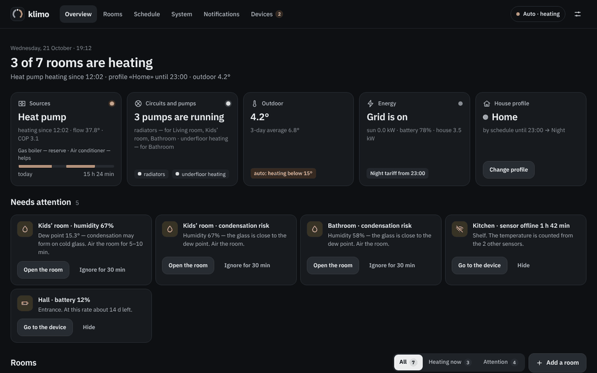

## Why an add-on (not an integration)?

- **Sidebar panel** via ingress — a mobile-friendly SPA for the whole household, no YAML. Only Home
  Assistant administrators change the configuration; everyone can control their rooms.
- **Own process** with a Supervisor watchdog: the control loop runs next to Home Assistant, not
  inside its event loop. It keeps deciding (and keeps the boiler relay's keep-alive honest) while
  Home Assistant restarts, and it resumes minimum run times, pump run-ons and retries after its own
  restart.
- **Own database** for the configuration, the decision journal, alerts and run history.
- **Locked down**: reached only through ingress, no extra privileges, and its own AppArmor profile
  describing exactly what it reads and writes (in complain mode for now) — security rating 8.
- **Controls any hardware through Home Assistant entities**: Zigbee2MQTT radiator valves, Shelly or
  Zigbee relays, the `climate` entity of a heat pump or an air conditioner, a flow-temperature
  `number`, scripts — anything Home Assistant can switch.
- **Native entities back** through MQTT discovery: a `climate` entity per room that any thermostat
  card, HomeKit or a voice assistant can use, plus selects, sensors and buttons for automations.

## Installation

One click — add this repository to your Home Assistant add-on store:

[](https://my.home-assistant.io/redirect/supervisor_add_addon_repository/?repository_url=https%3A%2F%2Fgithub.com%2FRobinCK%2Fklimo)

Then find **Klimo** in the store and click **Install**. Or add it manually:

1. In Home Assistant open **Settings → Add-ons → Add-on Store**.
2. Menu (⋮) → **Repositories** → add:

   ```
   https://github.com/RobinCK/klimo
   ```

3. Find **Klimo** in the store and click **Install** (the image is built locally on first
   install — this takes a few minutes).
4. Start the add-on — **Klimo** appears in the sidebar.

On the first start Klimo creates six profiles (Home, Away, Eco, Night, Guests, Vacation), a weekly
house schedule and five triggers (Blackout, Sun during blackout, Night tariff, Frost, Battery low).
They and the notifications start in English — rename anything, and pick the notification language in
**Settings → Units, languages and look**. Then:

1. **System → Sources → Add a source** for every heat pump, boiler, air conditioner or heater, with
   its gas or electricity meter if you have one.
2. **Rooms → Add a room**: give it a name and a Home Assistant area — Klimo offers the radiator valves,
   thermometers and window contacts of that area by kind, and **Add a device** finds anything else. The
   radiator and floor circuits are set up once, with the first room that needs them.
3. Check **Schedule** — which profile is in force when.

Klimo needs Home Assistant 2025.10 or newer. After every start it watches for 20 seconds before it
switches anything.

### Add-on options

All climate configuration lives in the web UI and applies instantly. The add-on options hold only
system-level settings:

```yaml
log_level: info          # trace | debug | info | warning | error
database:
  driver: sqlite         # sqlite (default) | mariadb | postgres
  # host: core-mariadb   # for external databases
  # port: 3306
  # name: klimo
  # username: klimo
  # password: "..."
telegram_bot_token: ""   # optional, from @BotFather
# mqtt_host: ""          # optional, only for a broker other than the Mosquitto add-on
# mqtt_port: 1883
# mqtt_username: ""
# mqtt_password: ""
```

- **sqlite** (default): everything lives in `/data`, which is included in Home Assistant
  backups — zero configuration, restore together with the rest of your system.
- **mariadb / postgres**: keep the data in an external database (use host `core-mariadb` for the
  official MariaDB add-on). An external database is not part of the add-on backup.
- With the **Mosquitto** add-on installed, MQTT credentials are picked up automatically from the
  Supervisor — no configuration needed. MQTT is only needed for the native entities and the
  Lovelace cards; control works without it.

## Concepts in short

| Concept | What it means |
|---|---|
| **Room** | A space with its own target, tolerance, sensors, windows and the things that heat or cool it: radiators with smart heads, radiators with ordinary valves (the room then works as a room thermostat), a floor, an air conditioner, a heater. A room can also be monitor-only. |
| **Sensors & aggregation** | Several thermometers per room become one value: median (default), average, weighted, coldest, warmest or the main sensor, with smoothing and outlier rejection. A sensor that stops reporting is left out; with no sensor at all Klimo falls back to the valves' own readings. |
| **Tolerance** | How far below the target heating starts and how far above it stops. Target 20° with tolerance −0.2 / +0.2 starts heating at **19.8°** and stops at **20.2°**; a request lasts at least 5 min, so nothing switches for every tenth of a degree. |
| **Windows** | A window open for 60 s pauses the room (or switches it to Eco, lowers the target, or only notifies); 2 min after closing it resumes. Without a contact sensor a fast temperature drop counts as an open window. |
| **Profiles & schedules** | A profile is a set of targets (Home 21°, Night 19.5°, Away 18°…) with per-room exceptions. A weekly schedule says which profile is in force; rooms can have their own schedule. Presence, a calendar event or a manual change can take over — in an order you choose. |
| **Manual control** | A room follows the **schedule**, is under **manual** control (it holds its own target with no end; the schedule does not touch it) or is **off** (frost protection stays). **Resume schedule** brings it back — per room, or for the whole house. |
| **Climate sources** | Whatever makes heat or cold, controlled through HA entities: a relay (dry contact), a `climate` entity, a flow temperature, scripts or any service calls. Each has guards — minimum run and pause, starts per hour, a confirmation that it really runs — and fails over to the next source when it does not answer. |
| **Circuits & pumps** | Radiators, underfloor heating and fan coils, set up once for the house; rooms join them. A floor runs as a whole with its source (the usual "floor pump with the boiler") or by zones with a valve in each room; a radiator pump runs while a room asks or with the source. Each pump keeps running for its **run-on** (3 min for radiators, 10 min for a floor by default) to take the remaining heat out of the loop. A **manifold**, where the sources meet the circuits, passes every source on it to each of its circuits and can have a primary pump of its own. |
| **Bivalence** | A heat pump and a boiler working together: alternately (below −10° only the boiler), in parallel or partly in parallel, plus "the boiler helps a heat pump that is not keeping up". |
| **Season** | Heating, between seasons or cooling, from the 3-day average outdoor temperature (below 15° heating, above 22° cooling), with hysteresis, a minimum dwell and month limits. Or set the house mode by hand. |
| **Triggers & actions** | A trigger is a live condition over Home Assistant (grid offline, solar power, night tariff, frost, battery low…). An action changes the rules while a trigger holds: allow or forbid sources, shift targets, pre-heat to the next schedule slot, run pumps only on demand. |
| **Energy budget** | During a blackout the electric sources share a power budget (4 kW by default): they start one by one, the least important is shed first, and below 20 % battery only frost protection runs. |
| **Meters & consumption** | A source can have a gas, an electricity and a heat meter. Klimo reads their long-term statistics from Home Assistant and shows what the source used per hour, day or month, what it cost, the gas per degree-day and the COP — it stores no readings of its own. |

## Tour

### Overview

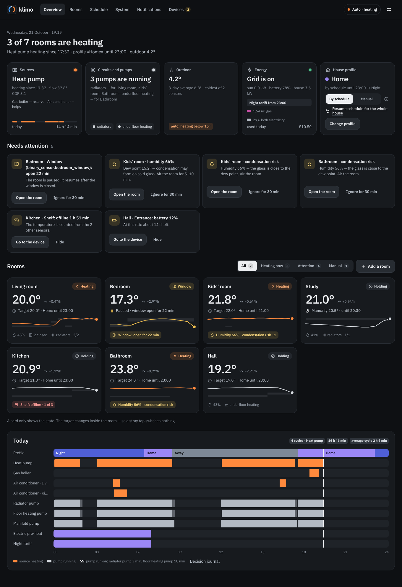

The house at a glance: how many rooms heat or cool, which source leads and since when, the pumps, the
outdoor temperature, the energy tile with today's gas, electricity and cost, and the house profile —
**By schedule** or **Manual** (the schedule paused), with a **Change profile** button that previews
what will happen before you apply it: which rooms stop heating, where the target drops. **Needs
attention** lists what is wrong with one-tap fixes, naming the device — open the room, ignore for
30 min, exclude a sensor from the calculation, go to the device. Room cards show the temperature,
trend, target with its source ("Home until 23:00", "Manually 20.5° · until 20:30"), humidity, windows
and a sparkline, and filter by what heats, needs attention or is under manual control; a card only
shows the state, so a stray tap changes nothing. **Today** draws the house profile, every source, pump
and trigger on one 24-hour strip.

### A room

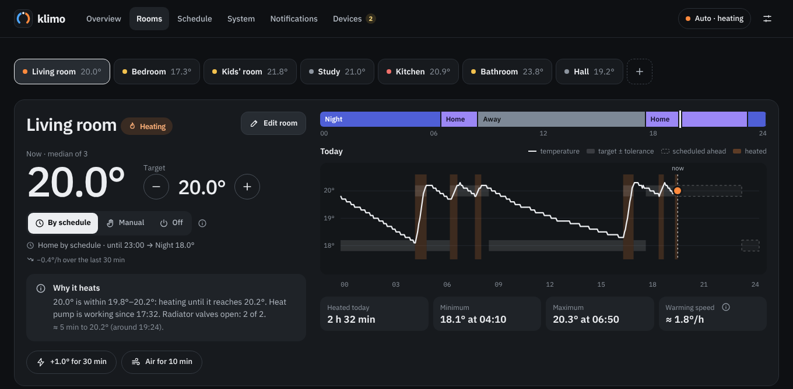

The room page answers "why": **Why it heats** spells out the comparison with the tolerance band, which
source works and an estimate of when the target is reached. Under the target,
**By schedule | Manual | Off** says how the room is controlled (see [Manual control](#manual-control)).
The target editor sends three seconds after the last tap and offers an undo for eight more; tap the
number to type a target. +1° for 30 min and **Air for 10 min** are one tap away. The **Today** chart
overlays the temperature with the target band, the heating periods and the scheduled targets ahead. It
is drawn from the room's own sensors as Home Assistant recorded them, so it shows the whole day also
after Klimo was restarted, and it grows with every new reading without a reload.

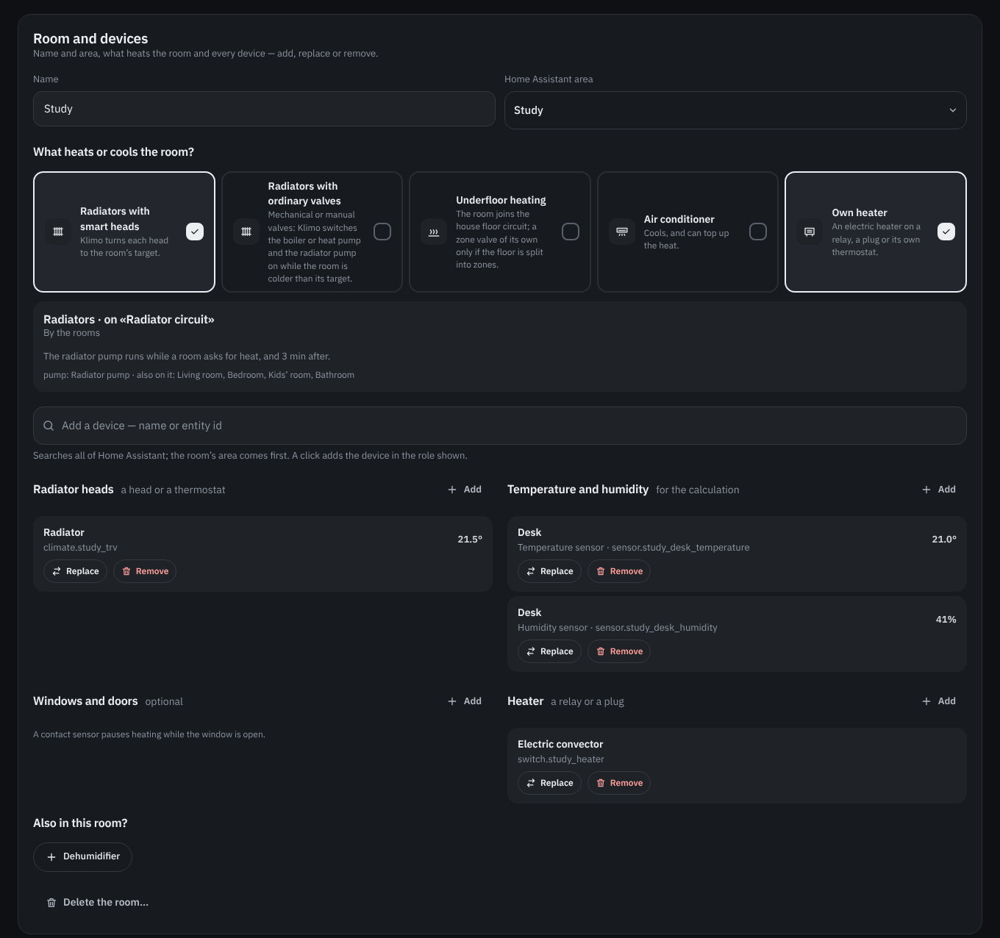

**Room and devices** (the **Edit room** button) changes the room after it is created: its name and
area, what heats or cools it, and every device in its block — **Add a device** (or **+ Add** in a
block) asks what it is and then finds it in all of Home Assistant; replace a device or remove it. A
removed radiator head gets its own sensor, a 20° target and an unlocked keypad back; a room that leaves
the floor gives up its place on the floor pump. Every change is in the journal.

The rest of the page is the room's configuration — what heats and cools it and how (an air
conditioner can top up the radiators when the room lacks more than 1.5°), the radiator valves with
their battery, signal and confirmation state, the temperature sensors and how they are combined, the
tolerance per mode, humidity and the dew point, windows and doors, smart functions and the room's own
notifications:

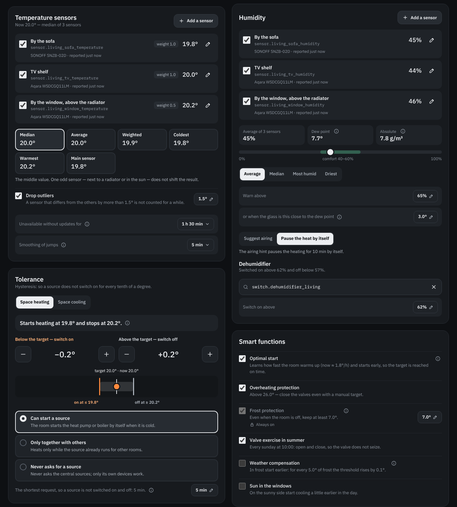

Radiator valves are driven the best way each model allows: the room temperature written into the
valve as an external sensor (recommended), a dynamic calibration offset, plain on/off setpoints, or
the valve opening in percent. A valve turned by hand keeps its value until the next schedule slot, is
reverted, or saves into the profile — your choice.

### Adding a room

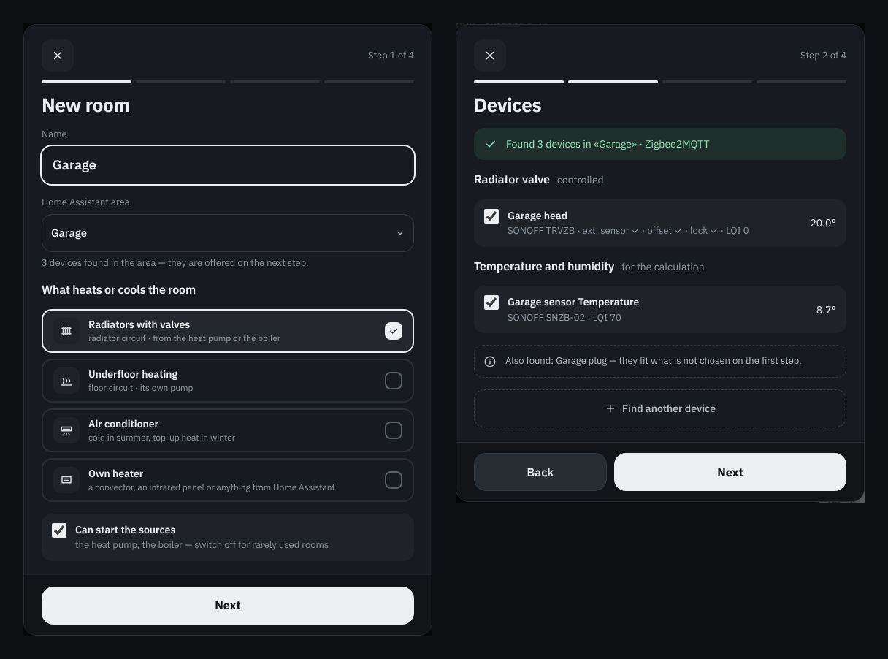

Four steps: the name, the Home Assistant area and what heats or cools the room; the devices; how to
control it (how the sensors are combined, the tolerance, the window reaction, how the valves are
driven); and a final check. On the devices step the area's radiator valves, thermometers and windows
are already there, one block per kind, and **Add a device** asks what a device is and then finds it in
all of Home Assistant — the area first; **+ Add** in a block does the same with the kind chosen.
**Radiators with ordinary valves** — hand valves or mechanical heads — need no device at all, only a
thermometer: the room then starts the boiler or heat pump and the radiator pump by its temperature.
A relay a source already switches cannot be added, and a circulation pump is not taken for a heater.
A room with radiators or a floor joins the house circuit, which the first such room sets up. Targets
come from the profiles; a device that belongs to another room is marked and can be moved here.

### Schedule & profiles

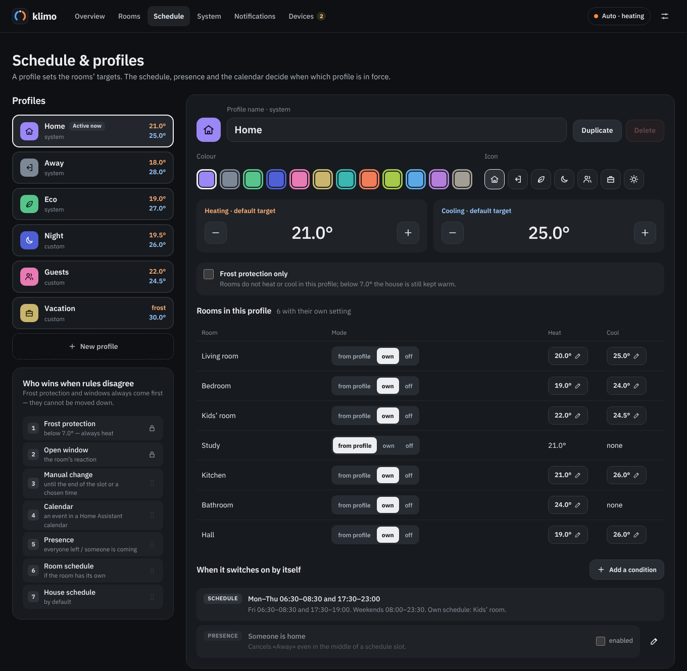

A profile carries a heating and a cooling target, a colour and an icon, and per room: from the
profile, its own targets, or off. **Who wins when rules disagree** orders the layers — frost
protection and open windows always come first, then manual changes, calendar events, presence, room
schedules and the house schedule. **When it switches on by itself** adds presence ("everyone left",
"someone is coming"), calendar events (Guests on the family calendar, with pre-heating) and vacations.

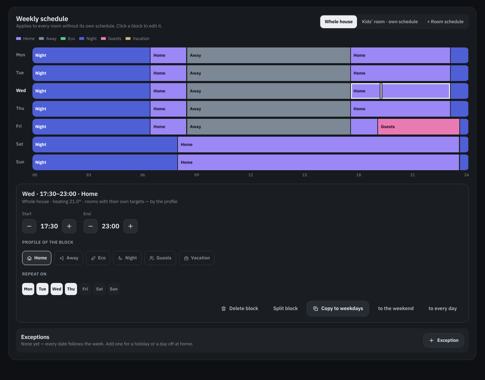

The weekly schedule is drawn as blocks of profiles; click a block to change its time and profile,
split it, copy it to weekdays, the weekend or every day. Rooms can follow their own schedule, and
exceptions cover holidays.

### System

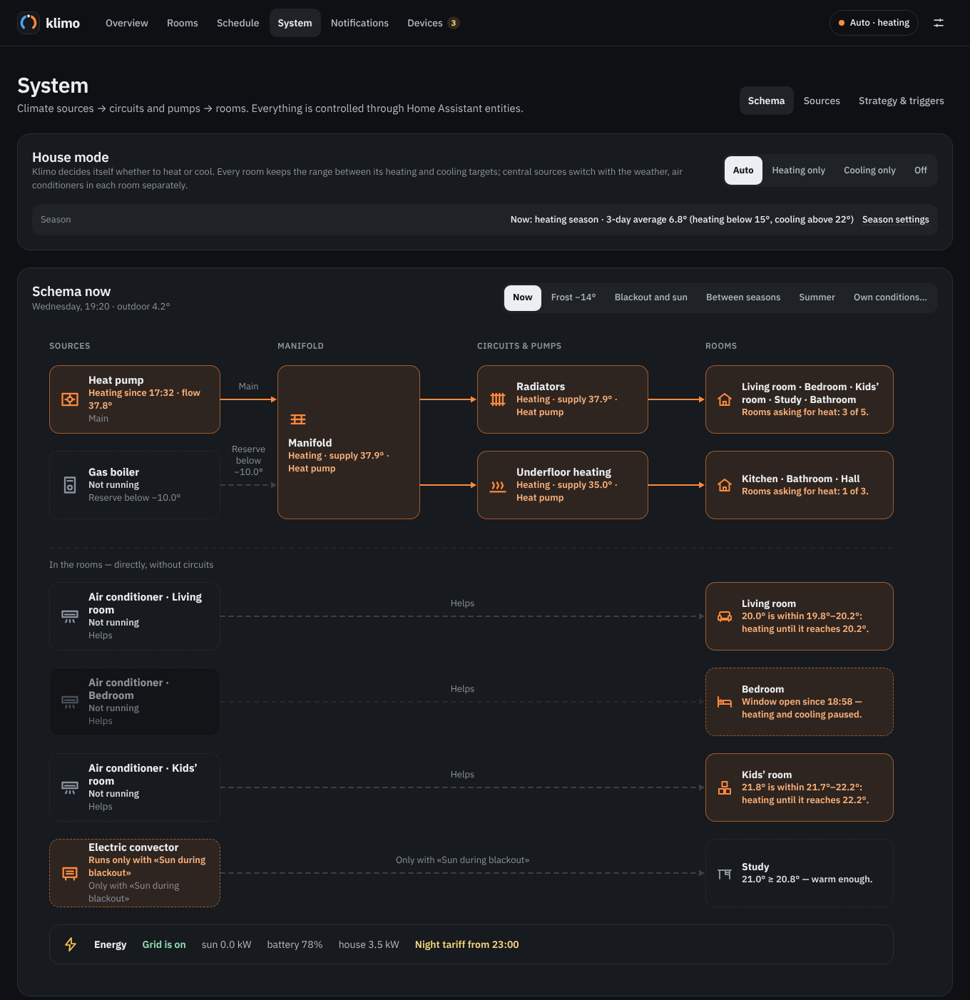

The live schema: sources → manifold → circuits and pumps → rooms, and the room-level sources (air
conditioners, a convector) on their own lines. The house mode (Auto, heating only, cooling only, off)
and the season sit on top; **Now / Frost / Blackout and sun / Between seasons / Summer / Own
conditions** replay the same plant under other conditions as a what-if, without switching anything.

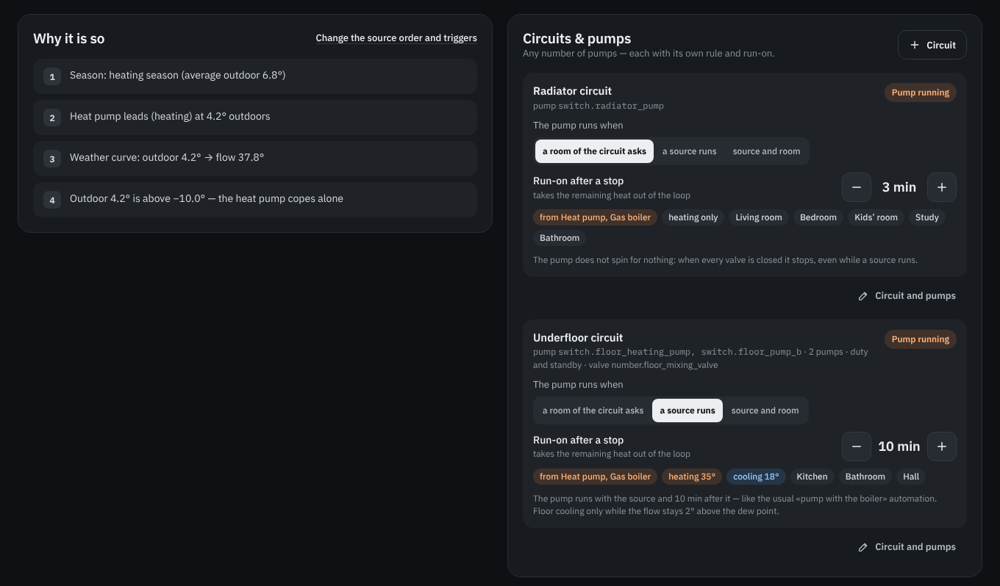

**Why it is so** lists the reasons behind the current choice (season, which source leads, the weather
curve, bivalence). The **Manifold** card is where the sources meet the circuits — a distribution
manifold or a hydraulic separator: the boilers and heat pumps that feed it, the circuits on it (each of
them gets their heat), its primary pump with its run-on, and the flow and return temperatures. Add it
with **+ Manifold** or the dashed **Add a manifold** box on the schema and open it by clicking it
there; a simple house with one boiler on one loop skips it. **Circuits & pumps** are the house's
heating loops: each card shows what feeds the circuit, when its pump runs, the run-on and the rooms on
it. A floor runs as a whole with its source — the familiar "floor pump with the boiler, 10 more minutes
after" — or by zones with a valve in each room; the radiator pump runs while a room asks or with the
source. A room with ordinary valves starts the source and the pump by its own temperature. Rooms are
added and taken off right on the card, and a house that 0.1.0 set up with a circuit per room merges
them into one.

### Sources

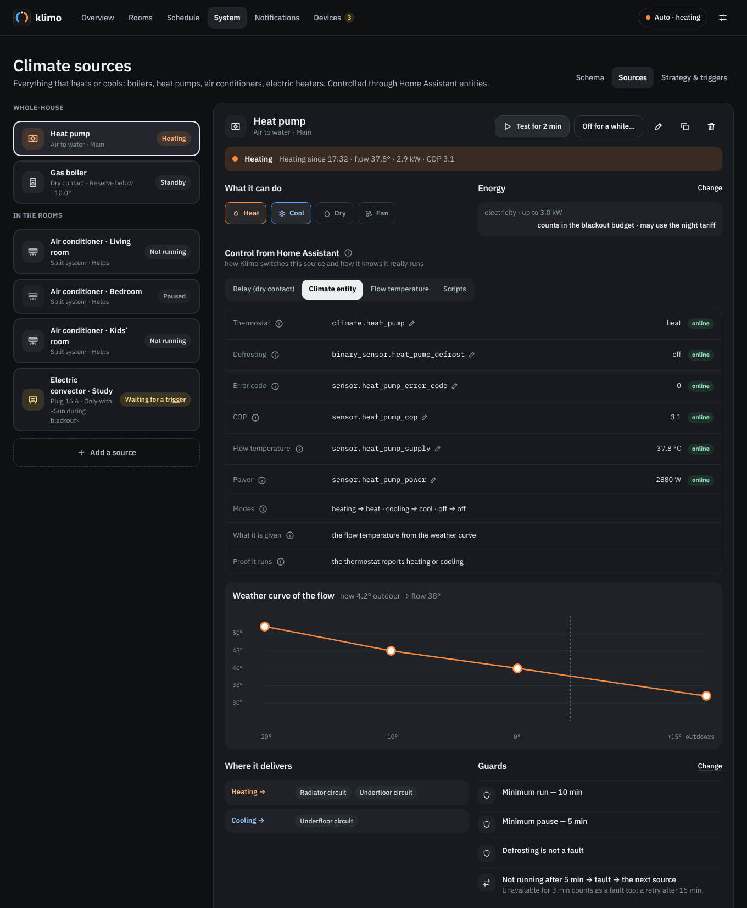

Every source with its live state: what it can do (heat, cool, dry, fan), how Klimo controls it and how
it knows the source really runs, the weather curve of the flow temperature, where it delivers — into
the manifold and/or straight into circuits, or for an air conditioner or heater its room (**Change**
opens the same choice as **Add a source**), guards (minimum run and pause, defrosting is not a fault,
failover after 5 min without confirmation), when it may run, its energy and its notifications. Every
Home Assistant entity it uses has an «i» that says what it is for, what to pick and what happens if it
stays empty. **Test for 2 min** starts it on the spot and reports whether it confirmed; **Off for a
while…** locks it out. Three identical air conditioners can be linked to one template and keep only the
differences.

### Consumption

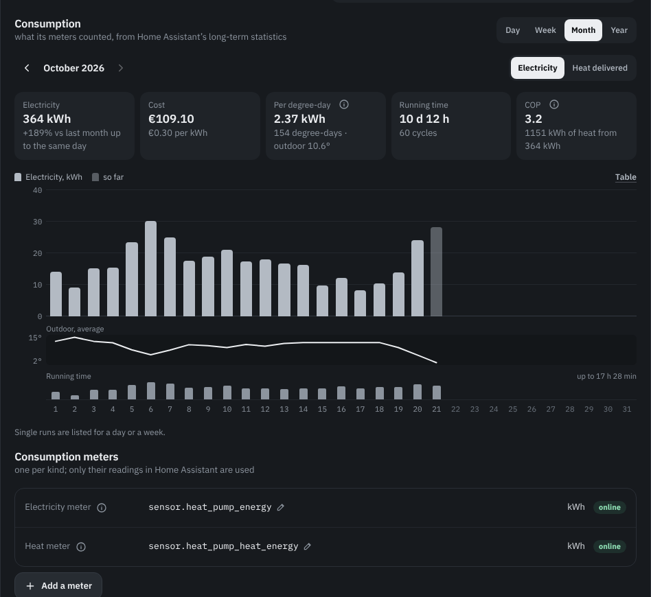

Bind a gas, an electricity or a heat meter to a source and its page shows what it used: the hours of a
day, the days of a week or a month, the months of a year, with the outdoor temperature and the running
time under the bars, and for a day or a week every run with what it used. The tiles add the change
against the period before, the cost, the gas or energy per degree-day (the weather taken out) and the
boiler's efficiency or the heat pump's COP. Klimo reads the meters' long-term statistics from Home
Assistant and stores nothing itself, so a meter bound today shows its whole recorded past. Prices are
set in **Settings → Energy prices**, and the overview's energy tile adds up today.

### Strategy & triggers

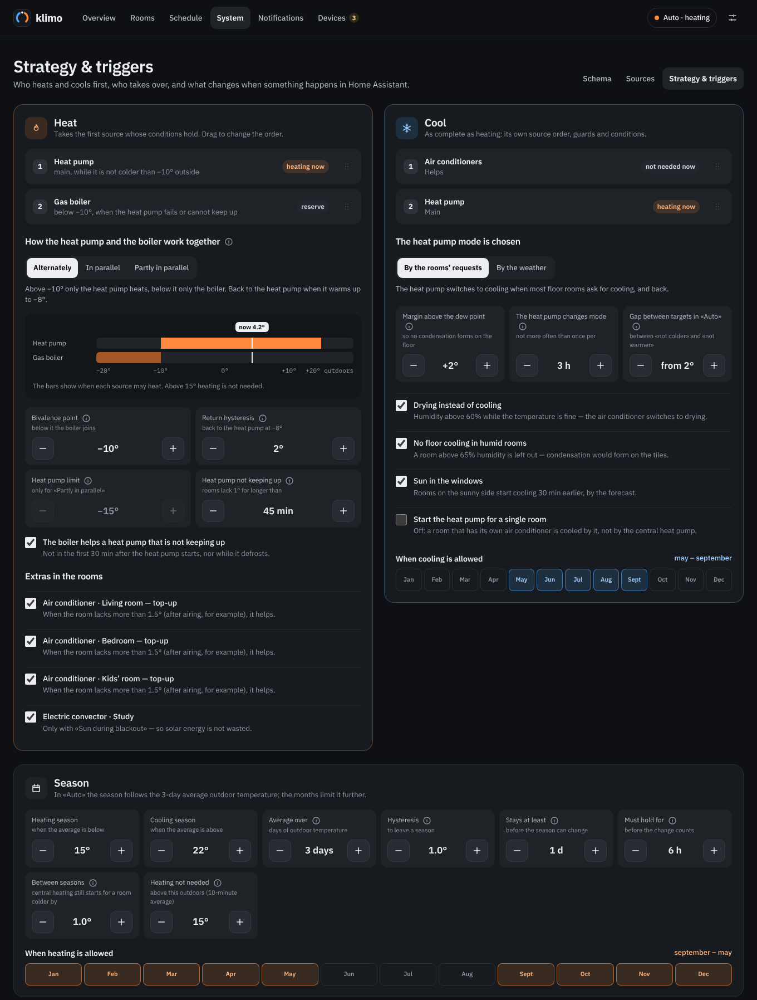

The heating and cooling chains (drag to change the order), how the heat pump and the boiler work
together, extras in the rooms, and the cooling rules: a margin above the dew point for floors, drying
instead of cooling above 60 % humidity, no floor cooling in humid rooms, pre-cooling of sunny rooms.
**Season** sets the thresholds, the averaging period and the months.

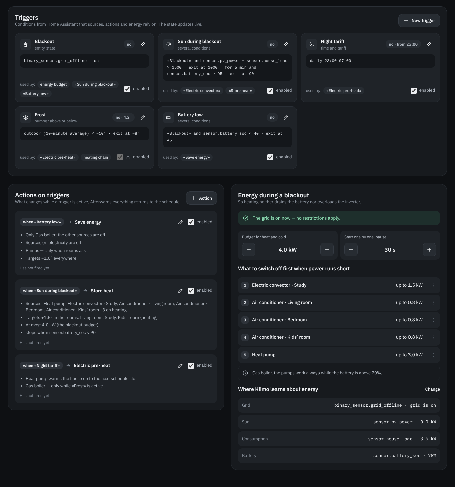

Triggers are conditions over Home Assistant entities with exit hysteresis and delays; actions say what
changes while a trigger holds. **Energy during a blackout** sets the budget, the start stagger, what
to switch off first and where Klimo learns about the grid, the sun, the house load and the battery.

### Decision journal

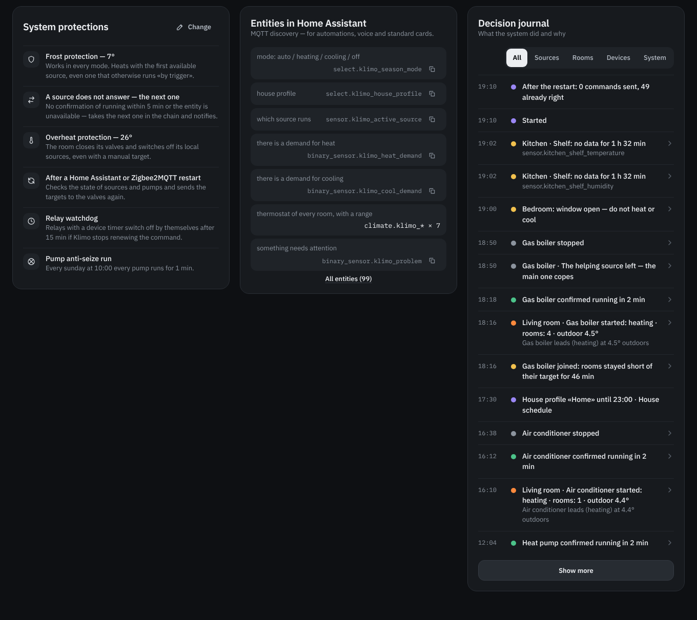

Every decision is written down with its reason — a source started because four rooms stayed short of
their target for 46 min, a pump runs on, a valve confirmed in 4 s, a window paused a room. Next to it:
the system protections in force and the entities Klimo publishes to Home Assistant.

### Notifications

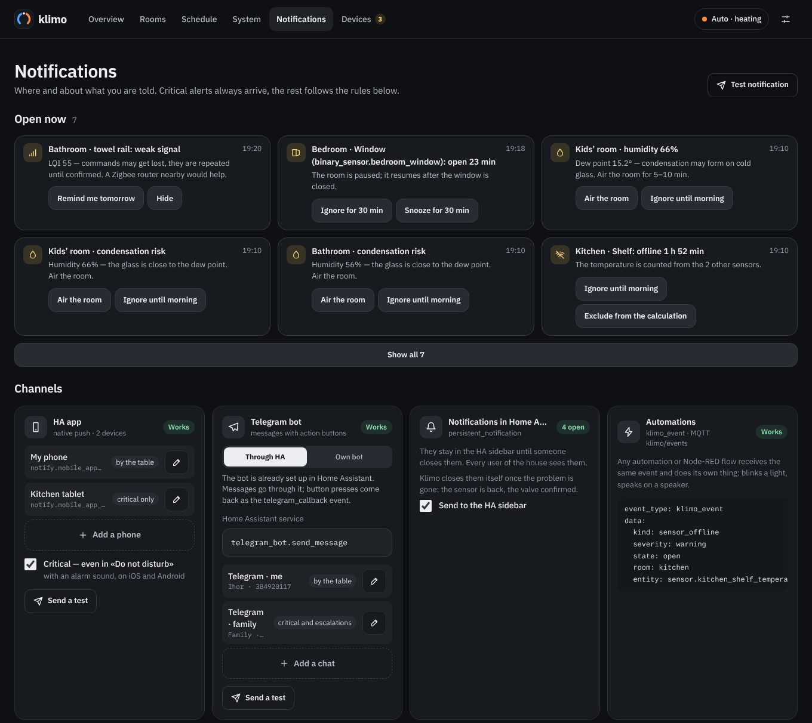

Open alerts with their actions, and the channels: the Home Assistant app on each phone, Telegram
(through Home Assistant or Klimo's own bot), the HA sidebar and an automation event. **What goes
where** is a matrix of events × channels; critical alerts always reach the primary phone.

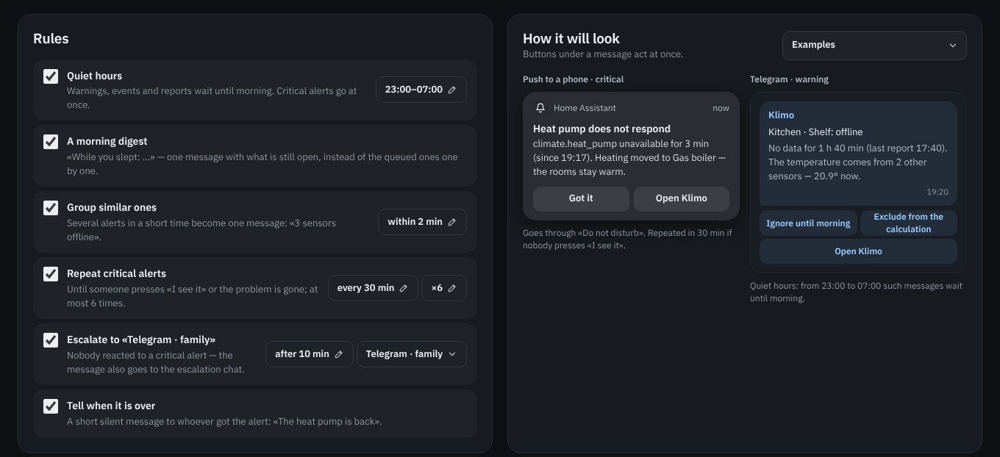

Quiet hours with a morning digest, grouping of similar messages, repeats and escalation of critical
alerts until somebody taps **Got it**, and a message when the problem is over. The preview shows how a
message will look on the phone and in Telegram.

### Devices

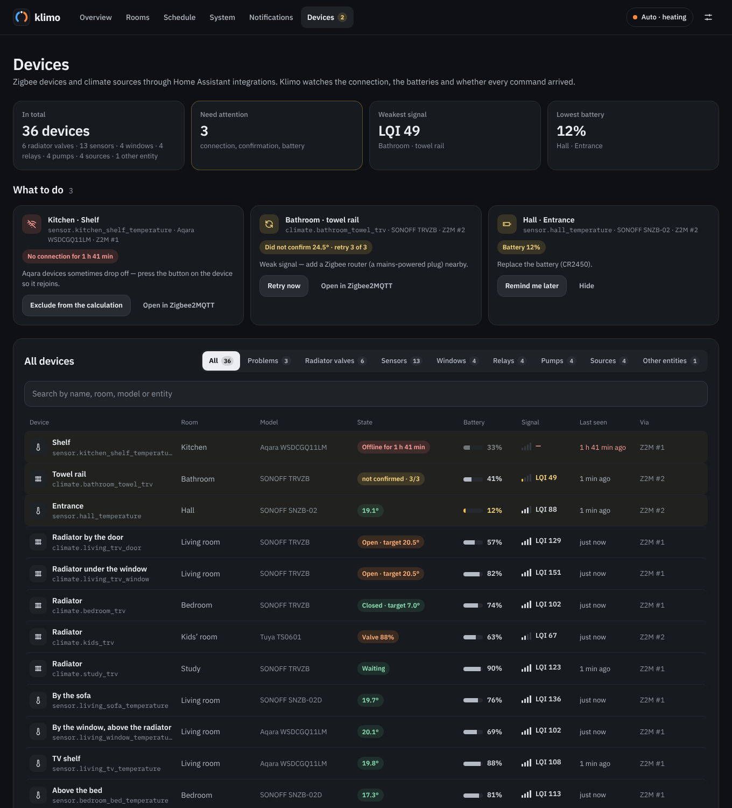

Every Zigbee device and climate source Klimo uses, with its room, model, state, battery, signal and
last report. **What to do** collects the devices that need a hand — a sensor that dropped off, a
valve on a weak signal, a battery running low with an estimate of how long it lasts. The page is live:
a device that comes back shows as back within a second or so, without a reload. With MQTT, link
quality, battery and last seen come straight from Zigbee2MQTT; a signal nobody reports is a quiet «—»,
not a weak one.

### Settings

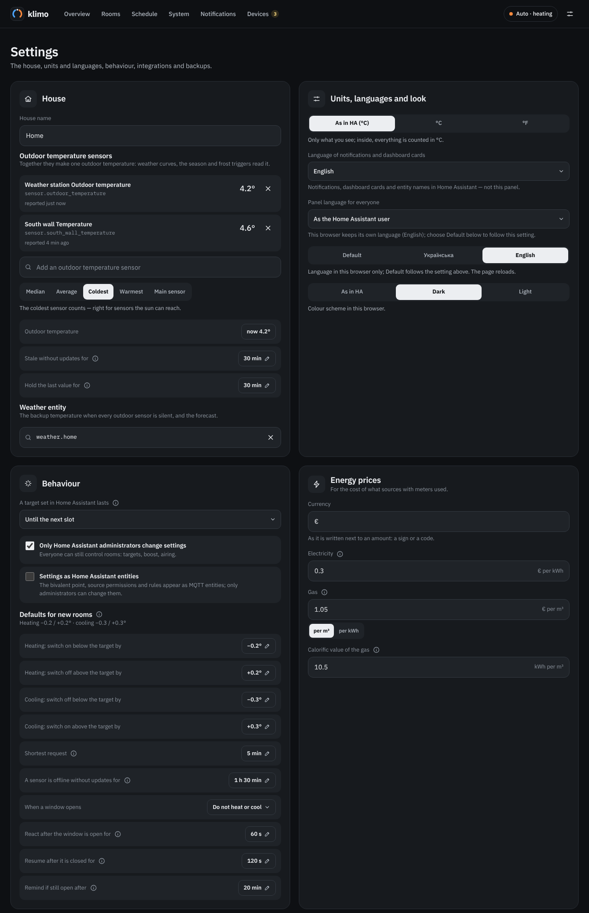

The outdoor sensors (one or several, combined like a room's — the coldest suits one the sun reaches)
and the weather entity, units (°C or °F, Klimo counts in °C inside), the language of
notifications and cards, the panel language for everyone and for this browser, the colour scheme, how
long a target set in Home Assistant lasts, defaults for new rooms, energy prices, the MQTT and Home
Assistant status with examples for controlling rooms from your automations, the dashboard cards, and
backup and restore of the whole configuration as one file.

### Phone and languages

The UI is built for the phone first — this is the overview and a room in the companion app:

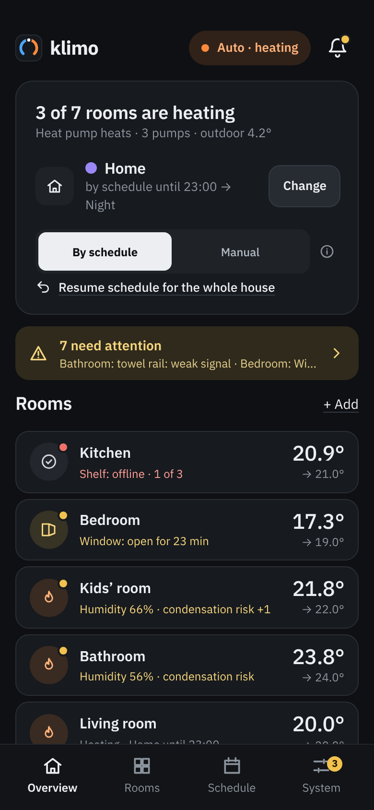 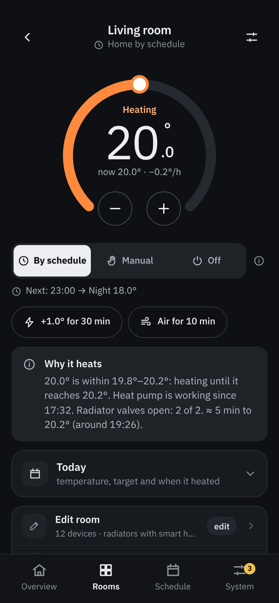

Every number has − and + (hold one to move faster) and can be typed: tap it, Enter applies, Escape
cancels. The number shows as many decimals as its step, so each press changes what you see.

The panel picks its language in this order: the choice made in this browser, the **panel language for
everyone** (Settings), the Home Assistant user's language, the browser's. Notifications, the cards and
the entity names have a language of their own, English on a new install. The same house in
Ukrainian:

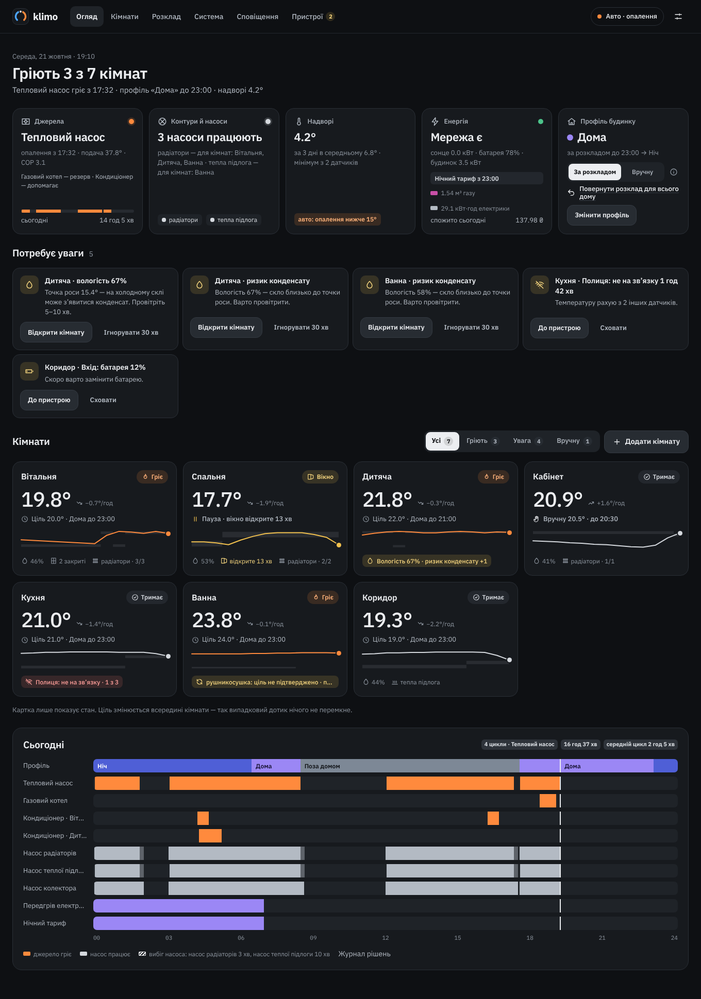

## Lovelace cards

Five custom cards control the climate straight from a Home Assistant dashboard. With the Mosquitto
add-on present they work with **zero setup**: the add-on copies `klimo-cards.js` into the `www`
folder of your Home Assistant configuration and registers it as a dashboard resource automatically
(on YAML-mode dashboards add the resource `/local/klimo-cards.js` as a *module* yourself).

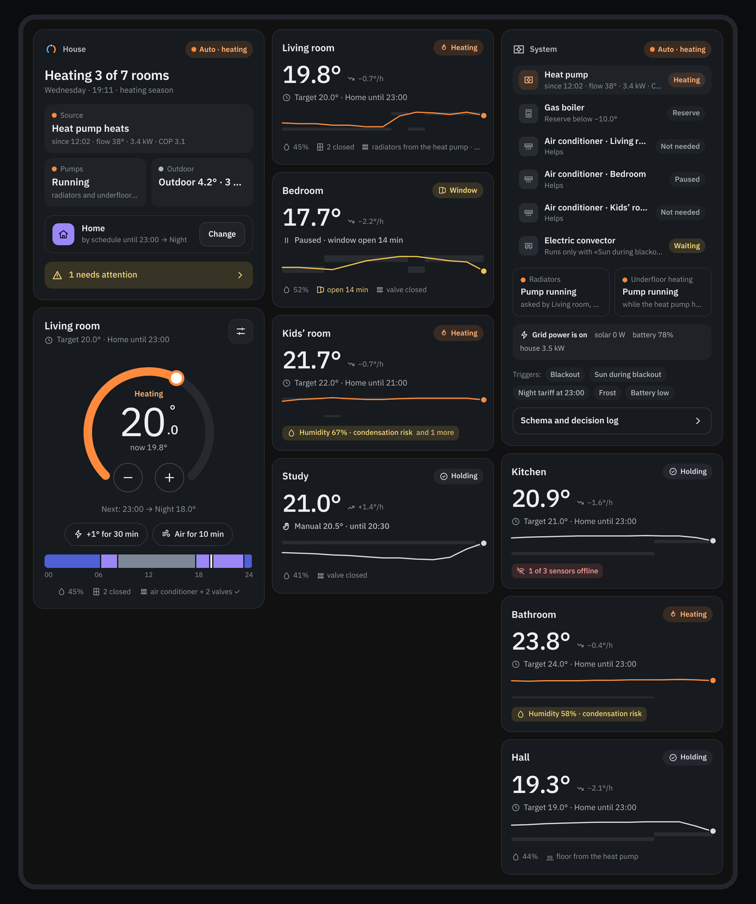

```yaml
type: custom:klimo-room-card           # one room at a glance; tap opens the room sheet
room: living_room                      # room slug, room id or climate.klimo_<slug>
variant: card                          # card | compact
```

```yaml
type: custom:klimo-rooms-card          # every room as a compact row
rooms: all                             # all | [slugs]
sort: attention_first                  # attention_first | config | name | temperature
```

```yaml
type: custom:klimo-thermostat-card     # the dial and Schedule | Manual | Off; 3 s to cancel, 8 s to undo
room: living_room                      # or rooms: all — swipe between rooms
durations: [slot, 1h, 3h, manual, forever]   # manual: until the schedule is resumed
quick_actions: [boost, airing]
```

```yaml
type: custom:klimo-house-card          # headline, sources, pumps, outdoor, profile, attention
profile_change: confirm                # confirm | navigate | none
```

```yaml
type: custom:klimo-system-card         # sources, circuits, energy and triggers
show: [sources, circuits, energy, triggers]
```

| Card | Main options |
|---|---|
| `klimo-room-card` | `room`, `variant` (`card` / `compact`), `show_sparkline`, `show_meta` (`humidity`, `window`, `device`), `show_issue`. Tap opens the room sheet with the target, quick actions and issues; hold opens the room in the Klimo panel. |
| `klimo-rooms-card` | `rooms` (`all` or a list), `exclude`, `variant`, `sort` (`attention_first`, `config`, `name`, `temperature`), `title`. |
| `klimo-thermostat-card` | `room` or `rooms`, `controls` (`direct`, `locked`, `admin_only`), `step` (0.1 / 0.5 / 1), `drag` (`knob_only` / `off`), `send_delay` (0–10 s), `undo_seconds` (0–30 s), `default_duration` (`slot`, `1h`, `3h`, `forever`), `durations`, `quick_actions` (`boost`, `airing`), `show_schedule`, `show_meta`. |
| `klimo-house-card` | `show_profile`, `profile_change` (`confirm`, `navigate`, `none`), `profile_durations`, `show_attention`, `show_system` (`source`, `pumps`, `outdoor`). |
| `klimo-system-card` | `show` (`sources`, `circuits`, `energy`, `triggers`), `sources` (`all`, `active` or a list of source ids). |
| every card | `theme` (`auto`, `dark`, `light`), `language` (`auto`, `uk`, `en`), `title`, `hub_entity`, `tap_action` / `hold_action` / `double_tap_action` (Home Assistant actions plus `klimo-room-sheet` and `klimo-open`). |

| Rooms | Thermostat | House |
|---|---|---|
| 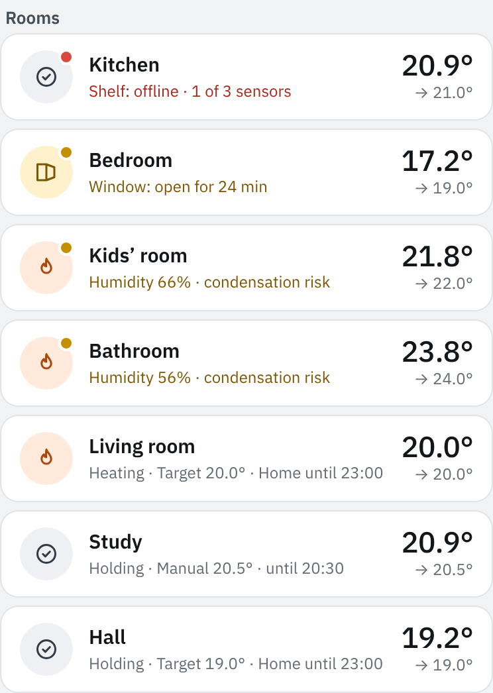 | 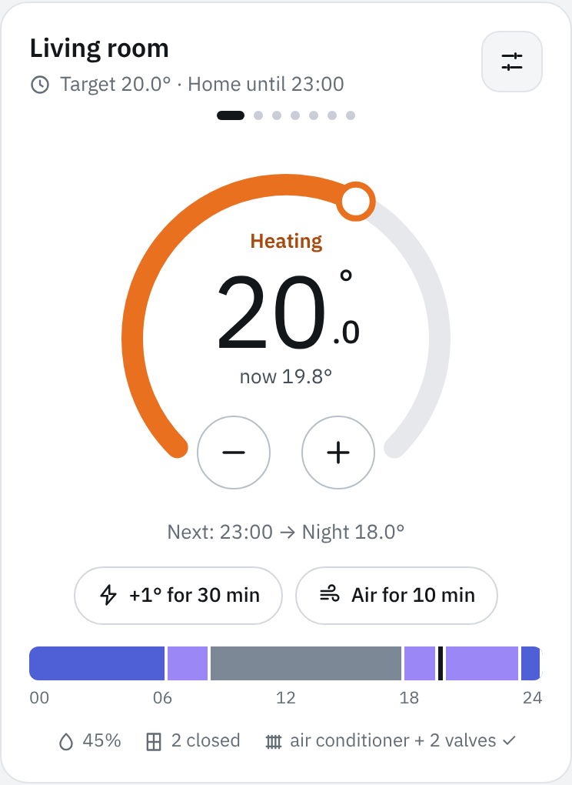 | 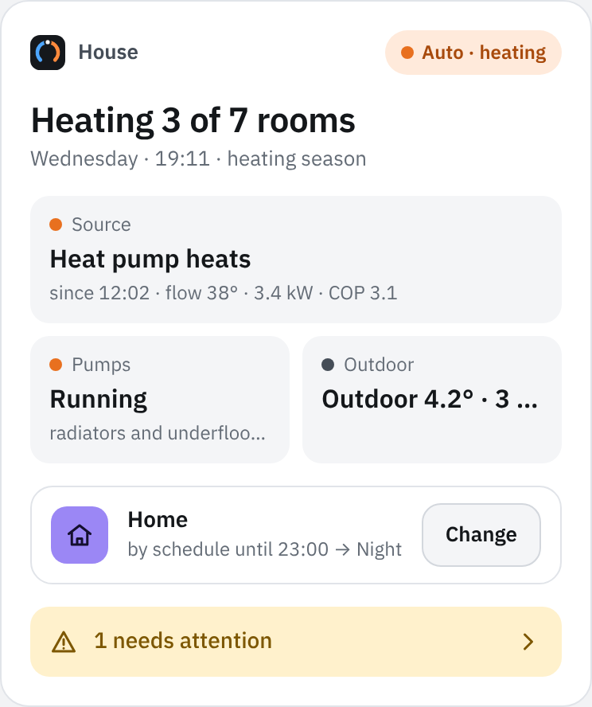 |

| Room | System |
|---|---|
| 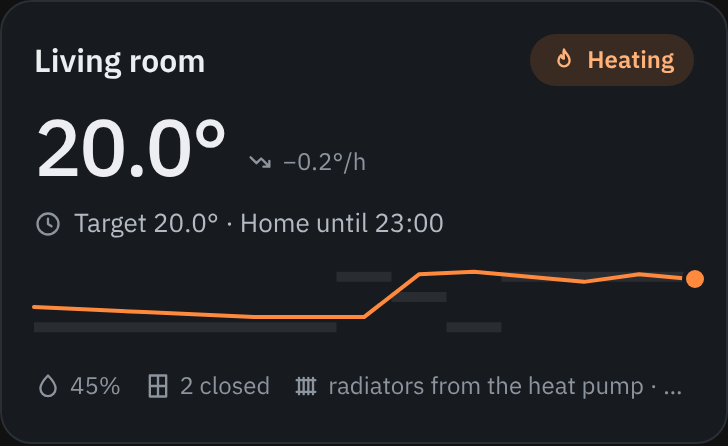 | 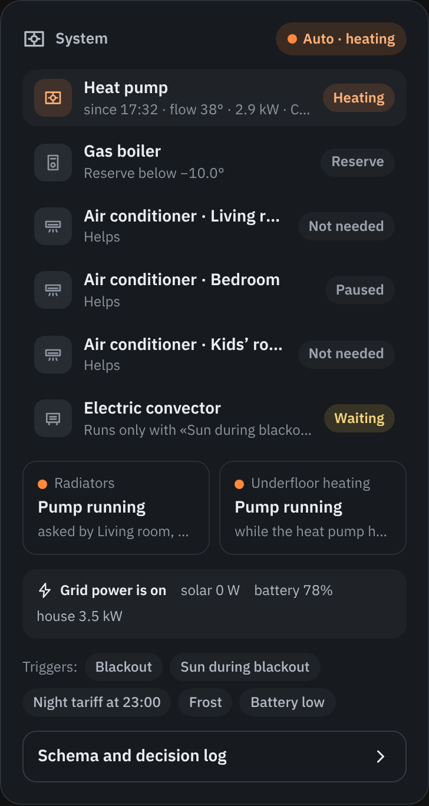 |

The cards read three sensors published over MQTT — the hub (`sensor.klimo_hub`), one card sensor per
room and a reply sensor — and send commands back through the `mqtt.publish` service. They find those
sensors by their attributes, so renamed entity ids keep working. Every card has a visual editor.

> **Requires MQTT.** The cards and the native entities below need a broker. Install the **Mosquitto
> broker** add-on and the **MQTT** integration — credentials are then picked up automatically. For an
> external broker set `mqtt_host` (and port, username, password) in the add-on options. The
> **Settings** page shows the MQTT status; see [Troubleshooting](#a-card-says-it-is-waiting-for-klimo-data).

## Manual control

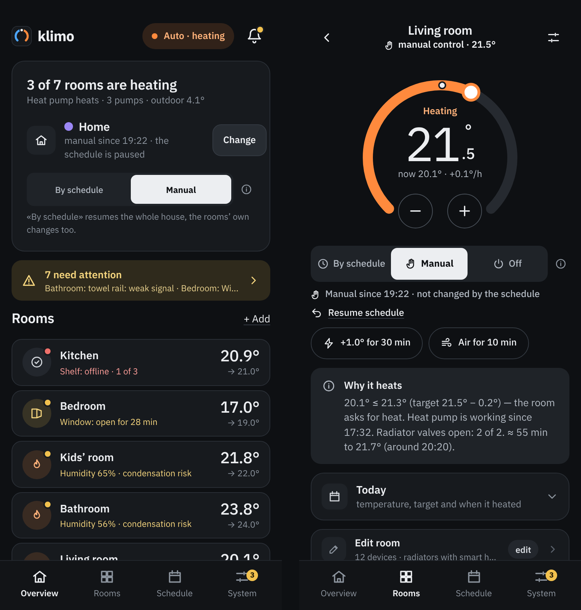

| Mode | What it means |
|---|---|
| **By schedule** | The room follows its profiles and schedules; a change for an hour or until the next slot ends by itself. |
| **Manual** | The room holds its own target with no end — the schedule, house profile changes and presence leave it alone. −/+ change the value without asking how long. |
| **Off** | The room is off until you switch it back; frost protection stays. |

An open window still pauses a manual room, and frost protection acts in every mode. Under manual
control the room reads "Manual since 19:22 · not changed by the schedule", with **Resume schedule**
beside it. The house profile tile pauses the whole house schedule on the current profile (**Manual**),
and **Resume schedule for the whole house** ends the house change and every room's manual or temporary
change — rooms switched off stay off. Manual control survives restarts, the thermostat card switches it
too, and the journal says who switched what.

From Home Assistant (an add-on cannot add services, so these do it):

```yaml
# a room under manual control at 21°; hvac_mode auto resumes its schedule, off switches it off
action: climate.set_temperature
target:
  entity_id: climate.klimo_vitalnia
data:
  hvac_mode: heat
  temperature: 21

# the room back to the schedule (button.klimo_resume_schedule: the whole house)
action: button.press
target:
  entity_id: button.klimo_vitalnia_resume_schedule
```

`select.klimo_<room>_control` (`Schedule` / `Manual` / `Off`) and `switch.klimo_schedule` (off = the
house schedule is paused) do the same, and a script can fire the event `klimo_command`:

```yaml
- event: klimo_command
  event_data:
    command: resume_schedule   # set_schedule | set_manual | set_off | set_target
    room: Living room          # id, slug or name; without it the whole house
```

Settings → Integrations has these examples with your own entity ids; the full reference is in the
[add-on documentation](klimo/DOCS.md#manual-control).

## Native HA entities (MQTT discovery)

Klimo publishes one **Klimo** device to Home Assistant:

- a **`climate.klimo_<room>`** per room — current temperature and humidity, target (or a low/high
  pair between seasons), `off` / `auto` / `heat` / `cool`, the profiles as presets and the action
  (heating, cooling, idle…). It works with any thermostat card, HomeKit and voice assistants; a target
  set there lasts until the next schedule slot (configurable) or stays manual in a manual room; `auto`
  resumes the schedule, `heat` / `cool` switch to manual control, `off` switches the room off.
- per room: the aggregated **temperature**, the effective **target**, humidity and dew point, heat and
  cool demand, the effective window state, the room state, the **control** select (schedule / manual /
  off) and **Resume schedule** / **Boost** buttons;
- for the house: `select.klimo_house_profile`, `select.klimo_season_mode`, `switch.klimo_schedule`
  (off = the house schedule is paused), the season, the outdoor average, the active source, heat and
  cool demand, a problem flag and the alert count, the power drawn during a blackout, **Resume schedule**
  (the whole house) and **Resend targets** buttons;
- one binary sensor per source, per circuit's pumps and per trigger — handy in automations.

Opt-in (**Settings → Behaviour → Settings as Home Assistant entities**): switches that allow a source
or enable an action, and the bivalent point as a `number`; their commands are accepted only from Home
Assistant administrators. Availability uses a last-will message, so a stopped add-on shows
*unavailable* instead of stale states. The full table is in the
[add-on documentation](klimo/DOCS.md#native-entities).

## History

Charts come from the **Home Assistant recorder**, not from a second database. A room's day is
rebuilt from its own thermometers exactly as Klimo combines them — the median of three, the main one,
an outlier left out — so it has no gaps while Klimo was stopped or updated. Klimo also publishes each
room's aggregated temperature and effective target as sensors: the target sensor draws the target band
of the elapsed day (the schedule fills any gap), and the temperature sensor stands in for a room whose
own sensors the recorder does not keep. Both are in Home Assistant's history and statistics too.
Klimo keeps only what the recorder cannot: the decision journal (30 days) and the run periods of
sources, pumps and profiles (up to 400 days).

Exclude the three transport sensors of the cards from the recorder — they change often and carry
large attributes:

```yaml
recorder:
  exclude:
    entity_globs:
      - sensor.klimo_hub
      - sensor.klimo_reply
      - sensor.klimo_*_card
```

## Notifications

- **Home Assistant app** (`notify.mobile_app_*`): actionable — "Got it", "Ignore until morning",
  "Exclude from the calculation", "Retry"; critical alerts sound through silent mode and Do Not
  Disturb (iOS critical alerts, the Android alarm stream).
- **Telegram** — through Home Assistant's `telegram_bot` integration, or through Klimo's own bot
  (`telegram_bot_token`), which keeps alerting while Home Assistant itself is down. Pair a chat with a
  one-time code from **Notifications → Add a chat**.
- **HA sidebar** (persistent notifications) and an **automation event** (`klimo_event`, also on the
  MQTT topic `klimo/events`) for Node-RED or your own automations.

Each event has a severity. Critical ones (a source that does not respond, frost risk, Zigbee2MQTT
offline, a critically low battery during a blackout) always reach the primary phone, ignore quiet
hours, repeat every 30 min until acknowledged and escalate to a second target after 10 min. The rest
waits for the end of quiet hours (23:00–07:00, with a morning digest) and similar messages are grouped.
Every message names the device and where it is — "Bedroom · Dresser: offline 20 min", with the entity id
when two devices share a name — and a grouped message or the digest gives each device its own line.
Messages are written in the notification language you pick in Settings, whatever the browser says.

## Reliability and fail-safe

| What fails | What Klimo does |
|---|---|
| **A room sensor** | Left out after 90 min without a report; the room is counted from the others and you get a warning. With no sensor left, the radiator valves' own readings (corrected by a learned offset) take over. |
| **A source** | No confirmation within its timeout, an error code, or unavailable for a few minutes → fault, and the next source in the chain starts on the same tick. A five-second blip never fails over. The source is retried after 15 min and takes the lead back when it recovers. |
| **A radiator valve** | Every command is checked against what the valve reports; three attempts, then a warning and a quiet retry every 15 min. |
| **An outdoor sensor** | Left out; the other outdoor sensors carry on. With none left, the last value is held for 30 min, then the weather entity. The heat pump is never stopped for missing data. |
| **Home Assistant** | Up to 2 min: carry on with the last states. Longer: decide for the UI but send nothing. After 10 min, Klimo's own Telegram bot reports it. On reconnect everything is compared with reality and resent where needed. |
| **MQTT** | Control is unaffected; the entities show *unavailable* and the cards say *Klimo is offline*. |
| **Klimo itself** | When the add-on is stopped, a boiler relay is switched off; if Klimo goes down, the relay keeps its last state. After a restart, minimum run and pause, pump run-ons and valve retries continue where they were — a boiler switched off a minute before the restart still gets its whole minimum pause. |
| **Someone else** | A change made by an automation or a person is recognised from Home Assistant's context. Two conflicting writes within 30 min → Klimo backs off for 10 min and tells you which entity and who. |
| **A cooled floor** | Supply water is kept above the dew point of the most humid room plus a margin; a room whose humidity is unknown is left out of floor cooling. A hard dew trip stops the floor and rests it for 30 min; three trips within 2 hours lock floor cooling until midnight. |

Keep the boiler's own frost protection enabled; it works even if neither Home Assistant nor Klimo
does.

## Migrating from automations

Klimo writes every entity it controls; an automation that writes the same entity fights it. Before you
switch a room over, disable:

- the automation that switches the **floor pump with the boiler** ("pump on with the boiler, off
  10 minutes later") — that is a floor circuit that runs as a whole with its source and a 10-min run-on;
- **thermostat helpers** (`generic_thermostat`, Better Thermostat, schedulers) on the same valves,
  relays or air conditioners;
- automations that turn valves down **when a window opens** — that is the room's window reaction;
- automations that switch the **boiler relay** from a TRV's heating demand — that is what the room
  requests and the source chain do.

Leave the valves' own open-window detection to Klimo (it can switch it off), and keep automations
that only *read* Klimo's entities. If something still writes, the **Changed by something else**
warning names the entity and whether it was an automation or a person.

## White-label

The panel is brand-neutral: everything that names or styles the product lives in
`klimo/frontend/src/brand` — the product name, wordmark and taglines (`brand.config.ts`), the mark
and its colours (`Logo.tsx`), the primary button, fonts, corner radius and neutral overrides, and the
documentation links. The UI-kit takes all of it through one provider, and `npm run check` fails if the
product name appears anywhere outside `src/brand`. The design tokens are shared with the Lovelace
cards: `npm run tokens:card` copies them into `klimo/card/klimo-cards.js`. Technical ids — the
`klimo` prefix of entities, MQTT topics and card element names — are not part of the brand.

## Documentation

- [Add-on documentation](klimo/DOCS.md) — the detailed feature guide (also shown in the add-on's
  Documentation tab).

## Development

```bash
# backend (NestJS + TypeORM) on the simulator: a virtual house on a fake Home Assistant
cd klimo/backend && npm install && npm run dev:sim
# frontend (React + Vite + Mantine) — dev server proxies /api to :8099
cd klimo/frontend && npm install && npm run dev
```

The **simulator** (`KLIMO_SIMULATE=1`, which `npm run dev:sim` sets) replaces Home Assistant with an
in-process fake that has a thermal model of a seven-room house: a heat pump, a gas boiler, three air
conditioners, a convector, two Zigbee2MQTT networks, an inverter, two outdoor sensors, gas, electricity
and heat meters with two months of statistics, and a family calendar. It also
serves the built panel from `klimo/frontend/dist` on port 8099. **Settings → Simulator** changes the
speed, the scenario, the outdoor temperature, opens windows and injects device faults.

| Variable | Default | Meaning |
|---|---|---|
| `KLIMO_SIM_SCENARIO` | `heating_evening` | `heating_evening`, `frost_morning`, `blackout_sun`, `shoulder` or `summer` |
| `KLIMO_SIM_SPEED` | `1` | virtual seconds per real second (0 freezes the clock, at most 600) |
| `KLIMO_SIM_LANG` | `en` | `uk` names the demo house in Ukrainian |
| `KLIMO_SIM_START` | the scenario's time | local start time, e.g. `2026-10-21T19:10` |
| `KLIMO_SIM_SEED` | `42` | seed of the sensor noise, so runs are reproducible |
| `KLIMO_SIM_WARMUP` | `1` | `0` skips the history warm-up |
| `KLIMO_SIM_HA_DELAY` | `0` | seconds after start before the fake Home Assistant accepts Klimo (a start racing HA) |
| `KLIMO_SIM_RECORDER_DELAY` | `0` | seconds after start while the recorder answers `unknown_command` (HA itself starting) |
| `KLIMO_SIM_KLIMO_DOWNTIME` | `0` | minutes before the scenario's moment that Klimo was down: its own MQTT sensors are recorded as unavailable |

The Lovelace cards can be developed without Home Assistant too: with the simulator running,
`http://localhost:8099/api/dev/cards?layout=tablet&theme=dark` (or `layout=phone`) renders the real
bundle against the virtual house, and `klimo/card/dev/harness.html` runs on static fixtures (serve the
`klimo/` folder over HTTP). `node klimo/card/dev/smoke.mjs` drives both card compositions in a real
browser; it uses a globally installed Playwright.

```bash
cd klimo/backend && npm test          # unit, integration and simulator end-to-end tests
cd klimo/frontend && npm run check    # layer boundaries + type check
cd klimo/frontend && npm run build    # what the add-on image builds
```

### Releases

A release is a commit that changes `version:` in `klimo/config.yaml` — that field is what the
Supervisor compares to offer an update, so bump it **last**, after the change is verified. Add the
matching `klimo/CHANGELOG.md` section in the same commit, then tag it:

```bash
bash scripts/tag-releases.sh --push
```

The script tags every released version that is not tagged yet, taking the tag message from that
version's changelog section, and is safe to re-run. A version counts as released once its changelog
section exists.

### Translations

The panel uses [i18next](https://www.i18next.com/); dictionaries are plain JSON in
`klimo/frontend/src/locales/`. The key **is** the English source text, so a missing translation falls
back to readable English rather than a blank or a key name, and `en.json` is the list of source
strings. Pages translate with `t()`, the UI-kit with `ut()`.

```bash
cd klimo/frontend
npm run i18n         # sync the dictionaries with the t() / ut() calls in the code
npm run i18n:check   # fail if they are out of date or a Ukrainian string is empty (CI)
```

`npm run i18n` adds strings that are new and removes strings that are gone, in every language at once;
new Ukrainian entries arrive as empty strings, which `i18n:check` refuses. Plural forms are generated
per language from the CLDR rules, so pass `count`: `t('{count} rooms', { count: 3 })`. Keys built at
runtime cannot be found by scanning the code — declare them in `src/i18n/dynamic.ts`.

Texts written by the backend — notifications, the journal, the reasons behind decisions, card texts
and entity names — live in `klimo/backend/src/notify/texts/` as `[en, uk]` pairs; a missing translation
there is a compile error. A new language therefore touches both sides: the `Lang` type in
`backend/src/shared/model.ts` (copied verbatim to `frontend/src/api/model.ts`), the backend text tables,
`LANGS` in `frontend/src/i18n/core.ts` and `locales` in `i18next-parser.config.js`.

## Troubleshooting

### A card says it is waiting for Klimo data

The cards look for the Klimo sensors among Home Assistant's *states*. Check, in this order:

1. **Do the entities exist, and are they enabled?** Settings → Devices & Services → **MQTT** → the
   **Klimo** device. Entities that were discovered but are *disabled* have no state, so a card cannot
   see them — enable them. They land disabled when *Enable newly added entities* is off for the MQTT
   integration (Integration → ⋮ → System options).
2. **Do they exist at all?** Developer Tools → States, filter for `klimo`. If nothing matches,
   discovery has not reached Home Assistant: check that HA's MQTT integration and the add-on use the
   same broker (Klimo's **Settings → Integrations** shows which one it uses), and use *Listen to a
   topic* on the MQTT integration page with `homeassistant/#`.
3. **Is the add-on running?** A stopped add-on publishes *offline* on `klimo/status`; the cards then
   say *Klimo is offline* until it is back.

### The card resource is missing

On a storage-mode dashboard Klimo registers `/local/klimo-cards.js` itself (Settings → Integrations →
Dashboard cards shows the result, with an **Install again** button). On a YAML-mode dashboard add it by hand:

```yaml
lovelace:
  resources:
    - url: /local/klimo-cards.js
      type: module
```

### A room does not heat

Open the room: **Why it heats** (or *Why it waits*, *Why it cools*) names the reason — the temperature is inside the
tolerance band, a window is open, the source is in its minimum pause, the season does not allow heating,
a trigger forbids the source. The decision journal on the System page shows the same reasons over time.

### A valve keeps saying "not confirmed"

The valve did not report the setpoint Klimo sent. Look at its signal on the Devices page (an LQI under
60 is weak — a mains-powered Zigbee router nearby helps), then use **Retry now**. Battery valves sleep
and answer late; Klimo retries three times before it warns.

### Something switches the pump or the boiler back

Another writer — usually an old automation. The **Changed by something else** warning names the entity
and whether the change came from an automation or a person; see
[Migrating from automations](#migrating-from-automations).

### The consumption chart is empty

Home Assistant keeps long-term statistics only for a sensor with a state class. Check the meter in
Developer Tools → States: a counter needs `state_class: total_increasing` (or `total`), a power sensor
`measurement`, and a unit Klimo knows — m³, ft³, L, kWh or MJ for gas, kWh, W or kW for electricity.
Set a missing state class in its integration or with `homeassistant: customize:`; the chart fills from
then on.

### `apparmor="ALLOWED"` lines in the host log

Klimo's AppArmor profile runs in complain mode: it blocks nothing, but logs any file access it does not
list yet. The host log (Settings → System → Logs, source **Host**) names the path — please report it; see
[Security](klimo/DOCS.md#security).

## License

MIT — see [LICENSE](LICENSE).
